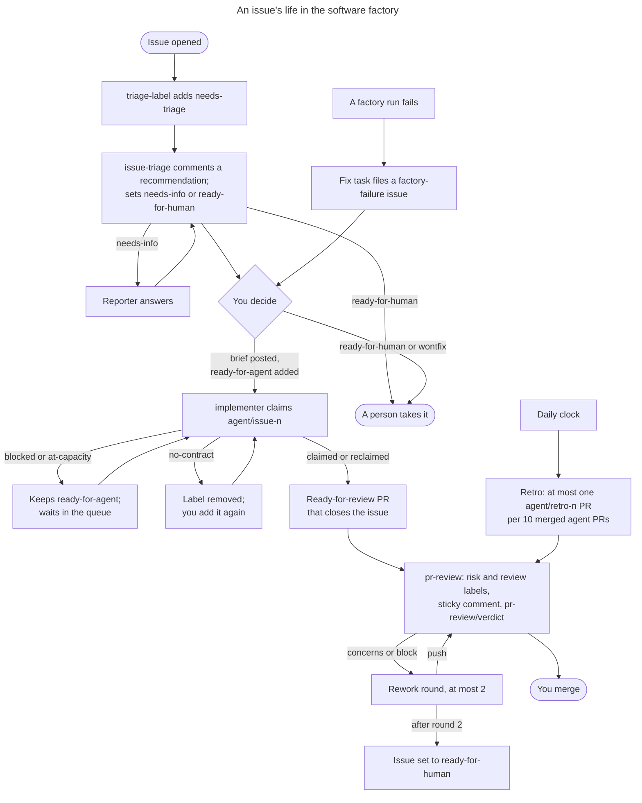

# Software factory: user guide

An issue that an agent could build still waited for you to open a Claude Code
session, watch it and check its pull request. The software factory removes
the wait: you write the issue and add one label, GitHub Actions runs the
agents on the Claude subscription, an automated review reads the pull request,
and you merge. Nothing merges without you, apart from one gated docs-only
exception ([ADR-0011](../adr/0011-pr-review-merge-exception.md)).

This page is for the maintainer who works with the factory day to day. It
assumes you know GitHub and Claude Code. How the parts fit together, for
whoever changes them: [architecture](architecture.md), with the checklist in
[changing a task](changing-a-task.md).

As of 2026-11-14 the factory runs every task in `fabiandistler/agents`, and
`fabiandistler/dotfiles` and `fabiandistler/repo-maintenance` call its
triage label, triage, PR review and implementer (onboarded in dotfiles#61
and repo-maintenance#153). The commands below name agents; in a target,
use its name.

## Contents

- [An issue's life](#an-issues-life)
- [Everyday tasks](#everyday-tasks)
- [What each label means](#what-each-label-means)
- [Troubleshooting](#troubleshooting)
- [Keeping this page current](#keeping-this-page-current)

## An issue's life



Text equivalent: a new issue gets `needs-triage` from the triage label task.
The issue triage task comments with a category and a recommended state; it
sets `needs-info` or `ready-for-human` itself and leaves every other state to
you; the reporter's answer to `needs-info` sends the issue back to triage. You post an agent brief and add `ready-for-agent`, which
starts the implementer. Its claim either stops the run or creates branch
`agent/issue-<n>` and builds a ready-for-review pull request that closes
the issue. A run stopped as `blocked` or `at-capacity` keeps
`ready-for-agent` and waits in the implementer queue, which starts it once
no run works and its blockers are done (where the implementer caller passes
no `queue_workflow`, it loses the label instead); one stopped as `no-contract` loses
the label until you add it again. The PR review labels the risk and the verdict, keeps
one sticky comment and sets the `pr-review/verdict` status. A `concerns` or
`block` verdict on an `agent/issue-<n>` pull request starts up to two Rework
rounds, each pushing a fix that is reviewed again; after the second, the issue
goes to `ready-for-human`. You merge whatever the verdict. Two tasks run
beside this path: the Fix task turns each failed factory run into one
`factory-failure` issue, and the Retro task may propose changes to the
factory's own prompts and runbooks after every ten merged agent pull requests
(`RETRO_EVERY`, [retro runbook](../agents/retro.md)).

## Everyday tasks

### Write an issue the factory can build

1. File it as a person with write access. The implementer builds only from
   text by an owner, member or collaborator; anyone else's issue stops as
   `no-contract` until such a person posts a brief.
2. Add an agent brief, recommended but optional for your own issues: a
   comment with a `## Agent Brief` heading in the format of
   [`.claude/skills/triage/AGENT-BRIEF.md`](../../.claude/skills/triage/AGENT-BRIEF.md),
   or run `/triage` in a Claude Code session. The latest such comment is the
   contract. Without one, the run works from the issue body and the comments
   by people with write access, and lists its reading under "Acceptance
   criteria (derived from issue)" in the pull request.
3. Declare blockers as `Blocked by #<n>` or as native issue dependencies. A
   blocker counts as done only when it is closed as completed.
4. Keep the deliverable out of `.github/workflows/`, `.claude/` and
   `.pre-commit-config.yaml`: a run cannot write there
   ([write limits](../wiki/problems/implementer-write-limits.md)). Do such a
   ticket in an interactive session, or ask the brief for the YAML in the
   pull request body under "Workflow to add by hand".
5. File issues one at a time: every issue, label and comment creates workflow
   runs ([issue tracker](../agents/issue-tracker.md), "Create many issues").

You need not wait for the triage comment before the next step.

### Start a run

Replace the state label, usually `needs-triage`, with `ready-for-agent`
yourself: an issue carries one state label, and a label added by a bot starts
nothing.

```bash
gh api --method DELETE repos/fabiandistler/agents/issues/<n>/labels/needs-triage
gh api --method POST repos/fabiandistler/agents/issues/<n>/labels -f "labels[]=ready-for-agent"
```

At most one implementer run works per repository at a time. A run ends with a
three-line summary on its run page (Actions, implementer, the run named
`implementer: issue #<n>`). When its pull request is ready, the review
requests you as reviewer, so GitHub notifies you.

### Read a review

On the pull request:

- **Labels.** One `risk:*` from the changed paths (the model can only raise
  it): `risk:low` is documentation only; `risk:medium` and `risk:high` always
  get `needs-review` and never auto-merge. One `review:*` holds the model's
  verdict; `needs-review` means you should look.
- **Sticky comment.** The findings, kept up to date in one bot comment.
- **`pr-review/verdict`.** Green for every verdict: it says the review of this
  head was published, not that it passed. `error` means the review was
  unavailable; `pending` means a draft.

The review only advises: `concerns` or `block` never blocks your merge, only
a missing or unavailable review does. On an
`agent/issue-<n>` pull request with `review:concerns` or `review:block`,
Rework starts by itself. Each round posts one comment that lists every finding
as fixed or declined, and its push is reviewed again. Rework is over at a
`review:pass`, or when a handoff comment appears and the issue gets
`ready-for-human`; then read the remaining findings and decide. Other pull
requests, Retro's included, get no Rework.

### Merge

You merge; agents never do (the merge guard blocks them). In agents, the
`default` ruleset makes the merge wait for the required checks,
`pr-review/verdict` among them
([runbook, setup step 6](../agents/pr-review-runbook.md#setup)); private
targets have no ruleset, so merge only when every check is green. The merge
closes the issue through the pull request's `Closes #<n>`. Add
`do-not-merge` to veto any auto-merge on a pull request.

### Handle a stopped or failed run

Read the bot comment on the issue, then the outcome tables in
[implementer claim](../agents/implementer-queue.md#implementer-claim); they say who
acts next. The cases that need you:

- **`at-capacity`, `blocked`.** The issue keeps `ready-for-agent` and waits
  in the [implementer queue](../agents/implementer-queue.md#implementer-queue)
  (#847), lowest issue number first. Close a blocker as completed, not as
  not planned. The queue runs after every implementer run, when an issue
  closes, and hourly as a fallback; after a run it dispatched itself, the
  implementer's `follow-up` job starts it (#863). Remove the label to take an
  issue out of the queue. In a repository whose implementer caller passes no
  `queue_workflow`, the claim removes the label instead: add it again once
  the blocker is done or the working run has ended.
- **`no-contract`.** The label is gone. Post the brief, then add
  `ready-for-agent` again.
- **`needs-human`.** Branch `agent/issue-<n>` has commits and no open pull
  request. Open a pull request from it, or delete it and add
  `ready-for-agent` again.
- **A red implementer run.** The issue usually keeps `ready-for-agent`, and
  adding a label that is already there fires no event. Read the run summary,
  then start the workflow again for the issue; the run ends at once if the
  label is gone, and it counts toward the one-run limit:

  ```bash
  gh api --method POST \
    repos/fabiandistler/agents/actions/workflows/implementer.yml/dispatches \
    --input - <<'JSON'
  {"ref": "main", "inputs": {"issue": "<n>"}}
  JSON
  ```

  Or remove the label and add it again. Either way, a branch with no commits
  of its own is taken over; one with commits stops as `needs-human`.
- **A draft pull request and `ready-for-human`.** The run's checks stayed red
  after its last round; the draft states the last failure. Finish it by hand.

### Onboard a new repository

1. From a checkout of agents, run the setup wizard (merged in #842 on
   2026-11-14) with your own `gh` login. It creates the labels, sets the
   `CLAUDE_CODE_OAUTH_TOKEN` secret (make the token first with
   `claude setup-token`), extends the Actions allow-list, and opens the pages
   to click for the Claude GitHub App.

   ```bash
   scripts/factory-repo-setup.sh --repo OWNER/NAME          # dry run
   scripts/factory-repo-setup.sh --repo OWNER/NAME --apply
   ```

2. Add the callers from the
   [caller templates](../agents/factory-onboarding.md#caller-templates), all
   pinned to the SHA of `gh api repos/fabiandistler/agents/commits/main --jq .sha`.
   Start slow, one pull request per stage, each merged to the target's
   default branch: `triage-label.yml` and `issue-triage.yml`, then
   `pr-review.yml`, then `implementer.yml` with `implementer-queue.yml`,
   whose first ticket is a trivial one.
3. After each stage, check; act on every `MISSING` line:

   ```bash
   GH_TOKEN=$(gh auth token) python3 scripts/factory_onboarding_check.py --repo OWNER/NAME
   ```

The [onboarding runbook](../agents/factory-onboarding.md) has the manual
fallback, what each check line means, and the rollback.

## What each label means

[Triage labels](../agents/triage-labels.md) is the source: the five issue
states, the implementer's claim outcomes, the Rework and Fix task outcomes,
and the pull request label families (`risk:*`, `review:*`, `needs-review`,
`do-not-merge`, `auto-merge:bot`). The [architecture](architecture.md#label-state-machine)
draws the issue states as a state machine.

## Troubleshooting

| Symptom | Cause | What to do |
| --- | --- | --- |
| The comment says another run is working; the issue keeps `ready-for-agent` | `at-capacity`: one implementer run at a time; the issue waits in the [queue](../agents/implementer-queue.md#implementer-queue), which checks at least hourly | Wait, or once that run has ended, [start it by hand](#handle-a-stopped-or-failed-run) |
| Implementer run red, issue still `ready-for-agent`, nothing happens | A failed run leaves the label; the Fix task files or comments on a `factory-failure` issue ([ADR-0016](../adr/0016-fix-task.md)); for a run the queue dispatched, the implementer's `follow-up` job starts it (#863) | Read the run summary, then [start it again](#handle-a-stopped-or-failed-run) |
| A required check, such as `secrets`, shows *Expected — Waiting* and never started | GitHub started no `pull_request` runs for that push ([wiki](../wiki/problems/missing-pull-request-runs.md)) | *Update branch*, or merge `main` into it, so a new push starts them |
| `pr-review/verdict` *Expected — Waiting* | No review published for this head | [Dispatch the review](../agents/pr-review-verdict-status.md#escape-a-head-without-a-verdict) with `"dry_run": "false"` |
| `review:unavailable` on every pull request, `pr-review/verdict` `error` | Missing or expired `CLAUDE_CODE_OAUTH_TOKEN`, an unknown `PR_REVIEW_MODEL` (both under *Settings, Secrets and variables, Actions*), a usage limit | [PR review troubleshooting](../agents/pr-review-troubleshooting.md#symptoms); after the fix, [re-run](../agents/pr-review-runbook.md#manual-re-run) each open pull request |
| Several factory runs fail within minutes, some after one turn | The shared 5-hour usage limit of the one Claude subscription ([wiki](../wiki/problems/shared-usage-limit.md)); timing is the evidence | Wait for the window to reset, retry each run (Actions, the workflow, *Run workflow*), close the `factory-failure` issues it filed |
| Red run, error says `pull_request_target` is not allowed | No event policy for the PR review caller | [Event policy](../agents/pr-review-event-policy.md) |
| No Rework round after a `concerns` review | The gate stopped: see its outcome table | [Rework outcomes](../agents/triage-labels.md#rework); Actions, rework, Run workflow |
| Retro did not run, or ran on the wrong pull request | The gate counts and labels `retro:done` | [Retro selection](../agents/retro.md#selection) |
| In a target, the App token exchange fails with `401 … Workflow validation failed` | The caller is not on the target's default branch yet | [Onboarding, before you start](../agents/factory-onboarding.md#before-you-start) |
| Runs stay `queued` with zero jobs | A GitHub Actions incident | [Wiki](../wiki/problems/actions-runs-stuck-queued.md) |

Runbooks: [PR review](../agents/pr-review-runbook.md),
[PR review troubleshooting](../agents/pr-review-troubleshooting.md),
[factory onboarding](../agents/factory-onboarding.md),
[Retro](../agents/retro.md), [skill audit](../agents/skill-audit.md).

## Keeping this page current

The dated lines (targets, the queue's workflows, the wizard) and the
troubleshooting rows go stale first; the wiki pages they link are dated history. Labels, outcomes and
inputs are linked, not copied, so their source pages stay authoritative. No
check reads this page's prose: the `mermaid` check parses the diagram only.
