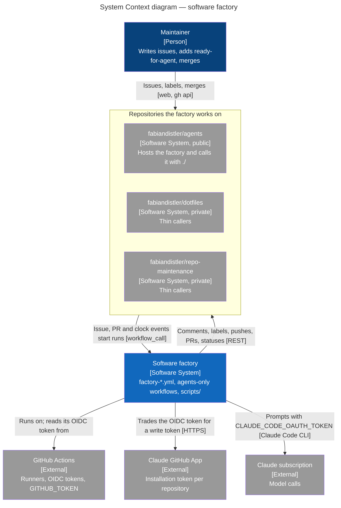
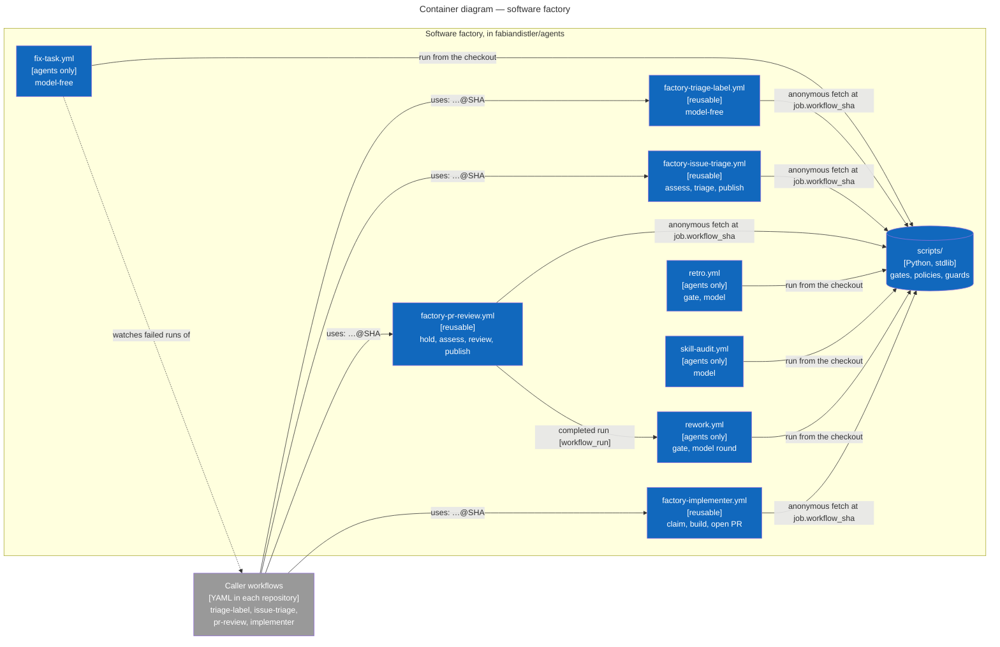
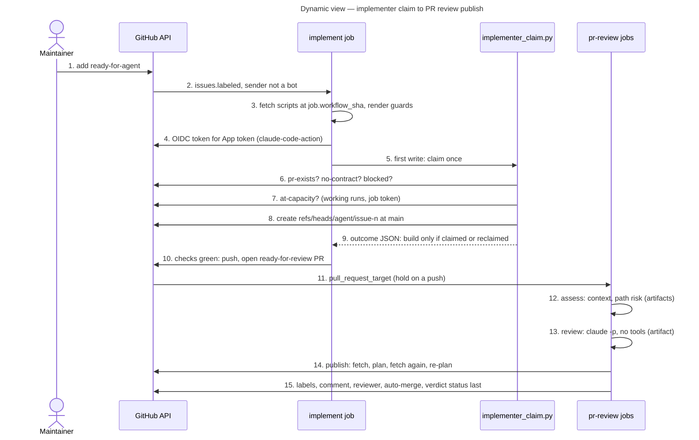
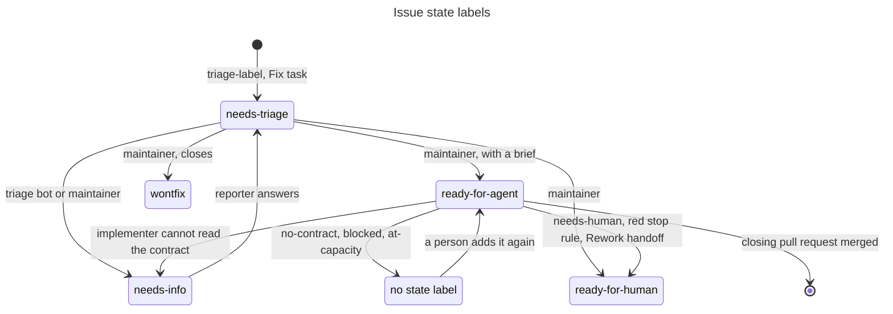

# Software factory architecture

For a developer, usually an agent session, about to change a factory task:
how the tasks, their gates and the reusable workflows fit together, and which
brake each part holds. Day-to-day use is in the [user guide](README.md); the
vocabulary (task, run, trigger, brake) is the
[software-factory skill's](../../.claude/skills/software-factory/SKILL.md).
Line numbers are at `fabiandistler/agents@3076881`; scripts are under
`scripts/` and workflows under `.github/workflows/`.

## Context and goals

Agents act under the maintainer's GitHub account, and agents that merged their
own pull requests produced red-CI merges and reverts (#557, ADR-0011). Yet a
clear issue should not wait for an interactive session. The factory runs
agents unattended in GitHub Actions and bounds every model by model-free code:
a model writes only where a gate, a guard or a human merge stands after it.

Goals: one issue becomes one reviewed pull request; one copy of each task
serves several repositories (ADR-0018). Constraints: one Claude subscription,
shared with interactive use; a personal account, so no organization rulesets
or required workflows; private targets on GitHub Free have no rulesets. Out of
scope: merging (the human), and starting a fix without a person.

## System context

Key: dark blue a person, blue the system in scope, grey external; arrows
point from the initiator.

Text equivalent: the maintainer works in three repositories, whose issue,
pull request and schedule events start the factory's runs on Actions
runners. A run that must push or open a pull request has
`claude-code-action` trade the job's OIDC token for a Claude GitHub App
installation token, scoped to the calling repository. Every model call uses
the maintainer's Claude subscription through `CLAUDE_CODE_OAUTH_TOKEN`. Runs
write back with that App token or with the job's `GITHUB_TOKEN`.

## Containers

Key: blue boxes are the factory's containers, grey the callers; a dashed
arrow is a watch, not a call.

Text equivalent: the **callers** (`triage-label.yml`, `issue-triage.yml`,
`pr-review.yml`, `implementer.yml`) hold the triggers, `permissions: {}`, the
scope cap and any secret by name; agents calls with `./`, a target pins a SHA.
They call four reusable workflows: **`factory-triage-label.yml`** (adds
`needs-triage`, no model), **`factory-issue-triage.yml`** (`assess` reads
issues, `triage` holds the model token and no GitHub token, `publish` writes
issues), **`factory-pr-review.yml`** (`hold`, `assess`, `review` with the
model and no write scope, `publish` with write scopes and no model token) and
**`factory-implementer.yml`** (one model step with the App token). **`rework.yml`,
`fix-task.yml`, `retro.yml` and `skill-audit.yml`** run in agents only and
read `scripts/` from their own checkout; Fix watches six workflows by name
(`fix-task.yml:14`). **`scripts/`** holds the model-free logic: the claim,
`pr_risk.py`, `pr_publish.py`, the gates and the two guards. `claude.yml`
(`@claude` mentions) is no factory task.

## Dynamic view: claim to verdict

Text equivalent: a person's label starts the implement job
(`factory-implementer.yml:68-74`). It fetches the scripts at the workflow's
own commit, renders both guards, and starts `claude-code-action`, which
trades the OIDC token for the App token. The
model's first write is `implementer_claim.py`, which stops with `pr-exists`,
`no-contract`, `blocked` or `at-capacity`, in that order, before any branch
exists (`implementer_claim.py:330-345`). Otherwise it creates the branch at
`main`. If the branch exists (422), a branch with no commits of its own is
fast-forwarded to `main` (`reclaimed`); one with commits is handed to a person
(`needs-human`, `:346-369`). The model builds, runs the caller's
`check_command` and opens a ready-for-review pull request. In the PR review,
`assess` fetches the context and classifies the risk, `review` asks the
model without tools, and `publish` re-fetches, aborts on a moved head
or a closed pull request, and otherwise writes labels, the sticky comment,
the reviewer, any auto-merge change and, last, `pr-review/verdict`
(`pr_plan.py:280-291`). The status goes last so a merge waits until the
verdict is visible; when an earlier write fails, `publish` withholds it and
turns red.

## The brakes and why

The implementer holds a token that pushes and opens pull requests, and it
reads issue text anyone can write. Without brakes, a prompt injection in an
issue would become a merged change. Each brake stops one path:

| Brake | What it stops | Where |
| --- | --- | --- |
| Trigger filter | A bot, or the run itself, starting a run | `factory-implementer.yml:68-74`; the action checks the actor's write access |
| Claim outcomes | Building from an outsider's text, on open blockers, beside another run, or over a branch with work | `implementer_claim.py:320-369`; `MAX_WORKING_RUNS`, `implementer_capacity.py:18` |
| Merge guard | An agent merging or enabling auto-merge | `pr_merge_guard.py`, loaded by `agent_run_settings.json` and `.claude/settings.json` |
| Push guard | An agent pushing to the default branch | `default_branch_push_guard.py`; as of 2026-11-14 only the implementer loads it (`factory-implementer.yml:202`) |
| Prompt hard limits | Labels, branches and files outside the task | the `prompt:` of each model step |
| App token | Writes to `.github/workflows/` | the App's permissions (ADR-0014) |
| Headless Claude Code | Writes to `.claude/` and `.pre-commit-config.yaml` | observed, cause inferred ([wiki](../wiki/problems/implementer-write-limits.md)) |
| Credential split | A model holding a write token in the review or the triage | separate jobs joined by artifacts |
| Risk labels | Auto-merge of anything but low-risk docs | `PATH_RULES`, `pr_risk.py:30`; the model may only raise the risk |
| Verdict status | A merge before the head's review is published | `pr_verdict_status.py:15`; green for any verdict |
| Ruleset | A merge on red checks, a push to `main` | ruleset `default`, agents only |
| Rework cap | Endless fix rounds | `MAX_REWORK_ROUNDS`, `rework_policy.py:25` |
| Human merge | Everything above failing at once | the maintainer |

Why the App token at all: pushes and pull requests made with `GITHUB_TOKEN`
start no workflow, so CI, the required checks and the review would never run
(ADR-0014). As of 2026-11-14 the ruleset requires five checks,
`pr-review/verdict` among them
([runbook setup step 6](../agents/pr-review-runbook.md#setup)), and a pull
request for `main`; that is what keeps `rework.yml`, `retro.yml` and
`skill-audit.yml` off `main`, since they load the merge guard from
`.claude/settings.json` but no push guard.

## Label state machine

Text equivalent: an issue holds at most one of the five state labels
(`STATE_LABELS`, `issue_triage_policy.py:26`). The triage label task, and the
Fix task for its own issues, start it in `needs-triage`. The triage bot may
move it to `needs-info`, and the reporter's answer moves it back (a target's
caller does not subscribe to comments, so there a person re-adds
`needs-triage`). From `needs-triage`, only the maintainer sets
`ready-for-agent`, `ready-for-human` or `wontfix`. From `ready-for-agent`,
three claim outcomes comment and remove the label, leaving no state until a
person adds it again; `pr-exists` changes nothing; `needs-human`, the
implementer's red stop rule, the Rework handoff and the Rework model's red
checks set `ready-for-human`. Pull requests carry separate families, written
only by `hold` and `publish`
([labels](../agents/triage-labels.md#pull-request-labels)).

## Data flow

A runner keeps nothing, so every fact one run hands the next lives on GitHub:

| Carrier | Written by | Read by |
| --- | --- | --- |
| Artifacts `pr-context`, `pr-assessment`, `pr-review` | PR review `assess`, `review` | `publish`; the Rework gate, by run id |
| Artifact `rework-findings` | Rework gate | Rework model job, its only task list |
| Artifacts `issue-context`, `issue-triage` | triage `assess`, `triage` | triage `publish` |
| Artifact `run-summary` (90 days) | implementer | Retro gate |
| PR comment `<!-- pr-review-bot -->` | `publish` (`pr_comment.py:14`) | `publish`, which edits only its own |
| Issue comment `<!-- issue-triage-bot -->` | triage `publish` | triage `assess`: two automatic triages per issue |
| PR comments `<!-- rework-round:<k> head:<sha> -->`, `<!-- rework-handoff head:<sha> -->` | Rework gate (`rework_policy.py:36-38`) | Rework gate (one per head; their count is the round), Retro gate |
| Issue body `<!-- factory-failure:<hash> -->` | Fix task | Fix task (dedupe) |
| Labels `retro:done`, `auto-merge:bot` | Retro gate; `publish` | Retro gate (counter); `hold`, `publish` (ownership) |
| Status `pr-review/verdict` | `publish` | the ruleset |
| Run name `implementer: issue #<n>` | `implementer.yml:17` | Fix task, Retro gate |
| `RUN FAILED: <reason>` in the run summary | model step | `agent_run_report.py`, whose `::error::` becomes the Fix task's signature |

Only markers in comments by `github-actions[bot]` count, so quoting one
changes nothing. Events from `GITHUB_TOKEN` writes start no workflow: that is
why Rework listens to `workflow_run` instead of the verdict label, and why the
Fix task cannot chain into a fix. Where data is lost: artifacts expire; the
Fix task's per-workflow group keeps one waiting run, so a third failure
replaces the waiting one, which is never filed ([ADR-0016](../adr/0016-fix-task.md)).

## Cross-repo specifics

- **Pins.** A target's four callers pin `fabiandistler/agents/.github/workflows/factory-*.yml`
  to one full commit SHA (`gh api repos/fabiandistler/agents/commits/main --jq .sha`)
  with the comment `# agents main, <date>`. A change reaches a target when a
  pull request bumping all four merges on its default branch; the App token
  exchange also checks the caller there
  ([onboarding](../agents/factory-onboarding.md#one-sha-for-all-callers)).
- **Anonymous fetch.** Every reusable job but the triage label's fetches
  `job.workflow_repository` at `job.workflow_sha` into `$RUNNER_TEMP/factory`
  without a credential (`factory-implementer.yml:141-154`), even when agents
  calls with `./`. agents must stay public: private, all those fetches fail,
  and on the owner's plan agents would lose its ruleset too.
- **Caller's context.** `github` and `vars` are the caller's, so
  `PR_AUTO_MERGE` and the model variables are set per repository
  (`factory-pr-review.yml:30-32`).
- **Private targets.** No rulesets on GitHub Free: nothing can be required,
  the push guard stops pushes to the default branch, and the maintainer
  merges only on green ([wiki](../wiki/problems/private-repos-no-rulesets.md)).
- **Capacity.** One implementer per repository, one subscription for all
  (ADR-0018, "Billing and capacity").

## Trade-offs and limits

Each decision, with its rejected options, is an ADR:
App write token in the model step instead of a model/publisher split
([0014](../adr/0014-agent-runs-in-github-actions.md)); the review on the
subscription through the CLI ([0012](../adr/0012-pr-review-on-claude-subscription.md));
a triage bot that sets only `needs-info` ([0013](../adr/0013-automated-issue-triage.md));
auto-merge for gated docs-only pull requests ([0011](../adr/0011-pr-review-merge-exception.md));
Rework on `workflow_run`, two rounds ([0015](../adr/0015-rework-task.md)); a
model-free Fix task that never starts a fix ([0016](../adr/0016-fix-task.md));
Retro on a clock, Proposed as of 2026-11-14 ([0017](../adr/0017-retro-task.md));
reusable workflows over copies ([0018](../adr/0018-reusable-factory-workflows.md)).

Known weaknesses, as of 2026-11-14: `at-capacity` has no queue (#801); a
failed run leaves `ready-for-agent` and nothing retries; the App token's
rights inside a target are unproven (ADR-0018, open question 1); the claim
branches from `main`, not the caller's default branch
(`implementer_claim.py:65`); the Fix task watches agents' runs only.

## How to change a task safely

A change can pass its tests in agents and still break a target weeks later,
when its pin is bumped. So check each layer before you push:

1. **Tests.** Structure tests pin each workflow's scopes, triggers, pins
   and prompt inputs (`scripts/test_*_workflow.py`, `test_pr_workflow_*.py`,
   `test_agent_run_workflows.py`); guard tests are `test_pr_merge_guard.py`,
   `test_default_branch_push_guard.py` and `test_agent_run_settings.py`. Run
   `scripts/check_all.sh`, or `--only pytest,zizmor` while iterating.
2. **zizmor** audits `.github/workflows/` offline. Suppress a deliberate
   finding inline with its reason, as `# zizmor: ignore[dangerous-triggers]`
   does.
3. **Pins.** Every `uses:` names a 40-hex SHA with a `# vX.Y.Z` comment
   (`test_workflow_action_pins.py`). The Claude Code CLI is pinned exactly
   (`factory-pr-review.yml:275`); rerun ADR-0013's sandbox check before a bump.
4. **Event text stays data.** Event values reach shells through `env:`, and
   prompts only as validated values and the repository name.
5. **Names are interfaces.** The claim counts runs by the called job's name,
   passed as `--job-name implement` in the prompt and listed by the jobs API
   as `<caller job> / implement`; Rework and Fix match workflow names; the
   event policy names `pr-review.yml`; Fix and Retro read the `run-name`; a
   renamed job or step files a new Fix issue.
6. **A new task** gets `permissions: {}`, the narrowest job scopes, a
   structure test, and its workflow name in `fix-task.yml` plus its path in
   `WATCHED_WORKFLOWS` (`factory_failure_policy.py:32`). A model step that
   pushes uses `claude-code-action` without `github_token`, writes
   `RUN FAILED: <reason>` into its run summary, is followed by an
   `agent_run_report.py` step, and loads both guards as the implementer does:
   `agent_run_settings.py` renders `agent_run_settings.json` for the action's
   `settings` input (`factory-implementer.yml:171-202`). The older
   agents-only tasks rely on the ruleset instead of the push guard.
7. **Roll out.** `pull_request_target` runs `main`'s pipeline, so a pull
   request that edits the review is reviewed by the old one. After the merge,
   bump each target's four callers to the new SHA by hand (ADR-0018, open
   question 5) and run `scripts/factory_onboarding_check.py` for its `pin`
   line.
8. **Interactive session needed** for `.github/workflows/`, `.claude/` and
   `.pre-commit-config.yaml`, or a brief that asks the implementer for that
   YAML in its pull request body, for the maintainer to commit.

`scripts/pr_*` and `.github/` are `risk:high`, so such a pull request always
waits for the maintainer.

## Keeping this page current

File:line citations shift with any edit to the cited file. The required
checks, target status and ADR statuses are dated because they change by
hand. No check reads this prose; the `mermaid` check parses the diagrams
only. Re-read this page when a `factory-*.yml`, a caller,
`implementer_claim.py`, `pr_plan.py` or a guard changes. The page sits
just under the `check-file-tokens` hook's 20000 bytes: before adding much,
move a section to its own page.
