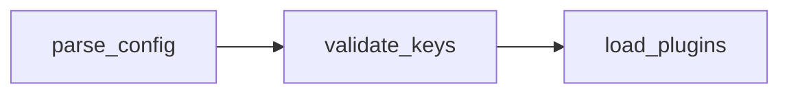

# Azure DevOps rules

What changes when the forge is Azure DevOps: the length cap, how work items
are linked, and which Mermaid renders. The sections, their order and the style
stay the same as on GitHub.

## Contents

- [Detect the forge](#detect-the-forge)
- [Length cap and shortening order](#length-cap-and-shortening-order)
- [Work items instead of Closes](#work-items-instead-of-closes)
- [The az line](#the-az-line)
- [Mermaid subset](#mermaid-subset)
- [Azure DevOps Server (on-prem)](#azure-devops-server-on-prem)
- [Sources](#sources)

## Detect the forge

Read the remote URL with `git remote get-url origin` (the remote the PR goes
to, when it is not `origin`). Never print or paste the URL: it can carry a
token. Match on the host, never on the whole URL: a path segment such as
`/acme/github-mirror/` says nothing about the forge. Lowercase the URL, take
the host, then match top to bottom, first match wins:

| Match | Forge |
|---|---|
| host `dev.azure.com`, `ssh.dev.azure.com` or `*.visualstudio.com` | Azure DevOps Services |
| host contains `github` | GitHub |
| any other host, path contains `/_git/` | Azure DevOps Server (on-prem) |
| anything else, or no remote | unknown |

The host is what follows the scheme (`https://`, `ssh://`) and an optional
`user[:token]@`, up to the next `:` or `/`; an scp-style remote
(`git@host:path`) has no scheme. In shell:

```bash
url=$(git remote get-url origin | tr '[:upper:]' '[:lower:]')
host=$(printf '%s\n' "$url" | sed -E 's#^[a-z][a-z0-9+.-]*://##; s#^[^@/]*@##; s#[:/].*##')
case "$host" in
  dev.azure.com | ssh.dev.azure.com | *.visualstudio.com) forge=azure-devops ;;
  *github*) forge=github ;;
  *) case "$url" in */_git/*) forge=azure-devops-server ;; *) forge=unknown ;; esac ;;
esac
```

This covers `https://dev.azure.com/<org>/<project>/_git/<repo>`, the SSH form
`git@ssh.dev.azure.com:v3/<org>/<project>/<repo>`, the legacy
`https://<org>.visualstudio.com/<project>/_git/<repo>` and its SSH form
`<org>@vs-ssh.visualstudio.com:v3/…`, GitHub over HTTPS and
`git@github.com:<owner>/<repo>`, and on-prem
`https://<server>/<collection>/<project>/_git/<repo>`. An unknown forge
(GitLab included) gets the GitHub body without forge-specific extras; say so
in chat.

## Length cap and shortening order

Azure DevOps rejects a PR description longer than 4,000 characters. Keep the
body (everything after the title line and the empty line) under 4,000
characters, and count it rather than estimating:

```bash
tail -n +3 <file> | wc -m
```

In a C or POSIX locale `wc -m` counts bytes, so umlauts count twice; that
errs on the safe side.

When it is over, shorten in this order and count again after each step:

1. **Section 3** down to one visual (preferably a diagram) plus one line per
   changed part. Drop every other visual and every explanatory paragraph.
2. **Section 6**: drop the discussion summary. The work-item and issue lines
   stay.

Sections 2 (Vorher / Nachher), 5 (Risiko & Schwächen) and 7 (Geprüft) are
never shortened: they carry the evidence and the risk. When the body is still
over the cap after both steps, stop: report the character count in chat and
propose splitting the PR. Never cut the evidence to fit.

## Work items instead of Closes

`Closes #<n>` does nothing on Azure DevOps. In section 6:

- List each work item the PR implements as `#<id>` with its title, one per
  line. In the web editor, `#` opens the work item picker that links it; a
  body pasted from a file is not guaranteed to link, so the real link is the
  `--work-items` flag below.
- `Teil von #<id>` for a work item the PR advances without finishing.
- Whether a linked work item closes on merge is a completion option of the PR
  ("complete associated work items"), not something the body controls.

Find work item IDs in the branch name (`feature/1234-…`), in commit messages
(`#1234`, `AB#1234`) and in the user's request. Never invent an ID; when none
is found, drop the work-item lines and leave `--work-items` out.

## The az line

Print this in chat after writing the file, for whoever opens the PR; never run
it yourself and never put it into the description:

```bash
az repos pr create --title "$(head -1 <file>)" \
  --description "$(tail -n +3 <file>)" \
  --source-branch "$(git branch --show-current)" \
  --work-items <id> <id>
```

- Replace `<file>` with the description's path and `<id>` with the work item
  IDs, space separated.
- Keep each `$(…)` in double quotes: `--description` turns every separate
  value into a new line, so an unquoted body breaks apart.
- Add `--target-branch <base>` only when the base is not the repo's default
  branch. `--detect` (on by default) reads organization and project from the
  remote.
- For a PR that already exists:
  `az repos pr update --id <pr> --description "$(tail -n +3 <file>)"` and
  `az repos pr work-item add --id <pr> --work-items <id> <id>`.

## Mermaid subset

Azure DevOps renders a standard ```` ```mermaid ```` fence in PR descriptions
since Sprint 274 (May 2026), with limited syntax:

- `graph TD` or `graph LR`, never `flowchart`;
- no HTML tags in labels (`<br>`, `<b>`), no Font Awesome icons (`fa:`);
- no long arrow `---->`, no edges to or from a `subgraph`;
- `sequenceDiagram`, `classDiagram`, `stateDiagram-v2`, `erDiagram`, `gantt`,
  `pie`, `journey`, `gitGraph`, `timeline` and `requirementDiagram` are
  supported.



When a diagram needs anything outside the subset, use a text visual (call
tree, file tree) instead.

## Azure DevOps Server (on-prem)

Whether Azure DevOps Server renders the ```` ```mermaid ```` fence in PR
descriptions is unconfirmed: the Sprint 274 feature timeline lists Server as
"Future". On Server, prefer text visuals over Mermaid and say in chat that
Mermaid support there is unconfirmed. The `az` CLI does not support Azure
DevOps Server, so print no `az` line; tell the user to link the work items
under "Work items to link" when creating the PR in the browser. The 4,000-
character rule is applied unchanged.

## Sources

- Mermaid in PR descriptions: Azure DevOps Sprint 274 update, "Standard
  Mermaid syntax in Markdown editors",
  https://learn.microsoft.com/azure/devops/release-notes/2026/sprint-274-update
- Mermaid subset: "Use Markdown in Azure DevOps", section "Work with Mermaid
  diagrams",
  https://learn.microsoft.com/azure/devops/project/wiki/markdown-guidance?view=azure-devops
- Work items and the CLI: "Create pull requests", section "Link work items to
  a pull request" (also states that the Azure DevOps CLI does not support
  Azure DevOps Server),
  https://learn.microsoft.com/azure/devops/repos/git/pull-requests?view=azure-devops
  and the `az repos pr create` reference,
  https://learn.microsoft.com/cli/azure/repos/pr?view=azure-cli-latest
- The 4,000-character cap: no Microsoft document states it. It is an observed
  limit; the service rejects longer descriptions, as reported for example in
  https://feedback.gearset.com/forums/283474-help-us-improve-gearset/suggestions/47072533-remove-limitation-of-number-of-prs-to-be-added-to
  If Microsoft documents a different value, the documented value wins.
