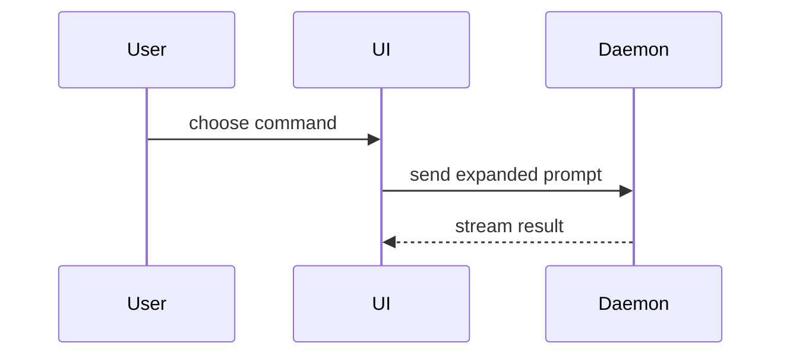

# Visual catalogue for "Was genau geändert wurde"

Adapted from Matt Pocock's `pr` skill in mattpocock/skills at upstream commit
`49dd158` (v1.3.1), Copyright (c) 2026 Matt Pocock, MIT License (full text in
`../UPSTREAM-LICENSE`). Pocock took this catalogue almost word for word from Dex
Horthy's `show-me` skill in humanlayer/skills, Copyright (c) 2026 HumanLayer,
MIT License (full text in `../UPSTREAM-LICENSE-HUMANLAYER`). Drift against
upstream is expected.

## Contents

- [Choosing a view](#choosing-a-view)
- [Pseudocode](#pseudocode)
- [Call tree](#call-tree)
- [Component tree](#component-tree)
- [File tree](#file-tree)
- [Mermaid](#mermaid)
- [Diff shaped like the topic](#diff-shaped-like-the-topic)
- [Whole block](#whole-block)
- [Placement](#placement)

## Choosing a view

Pick the smallest view that makes the key point clear. You may use one of
these, you may use several; it is unlikely you will use all of them. Use your
judgement and don't overwhelm the reviewer. Labels and comments inside a visual
are German prose; identifiers stay as they are in the code.

## Pseudocode

Show logic or an algorithm as pseudocode:

```text
on(save)
  if content is unchanged
    return cached result
  write new content
  return fresh result
```

## Call tree

Show runtime control flow as a call tree:

```text
submitForm
  createSession
    persistPrompt
    launchAgent
  navigateToSession
```

## Component tree

Show UI structure as a component tree, including the state and module
boundaries that matter:

```text
<SessionPage> (apps/example/src/routes/session.tsx)
  useSessionEvents()
  <SessionToolbar>
    <RunSkillButton> (packages/ui)
```

## File tree

Show file responsibility or a broad refactor as a shallow file tree:

```text
src/
├── commands/       # liest Benutzeraktionen
├── sessions/       # hält den Session-Zustand
└── transport/      # schickt API-Requests
```

## Mermaid

Show component interaction, control flow, or data flow with Mermaid. Write
flowcharts as `graph TD` / `graph LR` rather than `flowchart`, with no HTML in
labels, so the diagram renders on every forge.



## Diff shaped like the topic

Use `diff` when the point is what changes and the surrounding shape already
exists. Match the diff shape to the topic.

For a component change:

```diff
 <SessionPage>
   useSessionEvents()
   <SessionToolbar>
+    <RunSkillButton />
   <SessionTimeline>
+    <SkillResultCard />
```

For a file-layout change:

```diff
 src/
 ├── commands/
+│   └── show-me.ts       # löst den Skill-Aufruf auf
 ├── sessions/
-└── transport.ts
+└── transport/
+    ├── client.ts
+    └── stream.ts
```

For a call-tree or call-stack change:

```diff
 submitForm
   createSession
     persistPrompt
+    expandSkillMention
     launchAgent
-  navigateToSession
+  navigateToSession
+    subscribeToEvents
```

For a state or control-flow change:

```diff
 on(save)
-  write content
+  if content is unchanged
+    return cached result
+  write new content
+  invalidate cache
```

## Whole block

Show the whole block when most of it is new, when omitted context would hide
ownership or order, or when the reviewer needs a copyable target shape:

```ts
function expandSkill(command: string): string {
  const skillName = command.slice(1);
  return `use the ${skillName} skill`;
}
```

## Placement

Place each visual next to the short text it supports. Keep only the calls,
files, props, states, and boundaries the reviewer needs to understand this
change; cut everything else.
